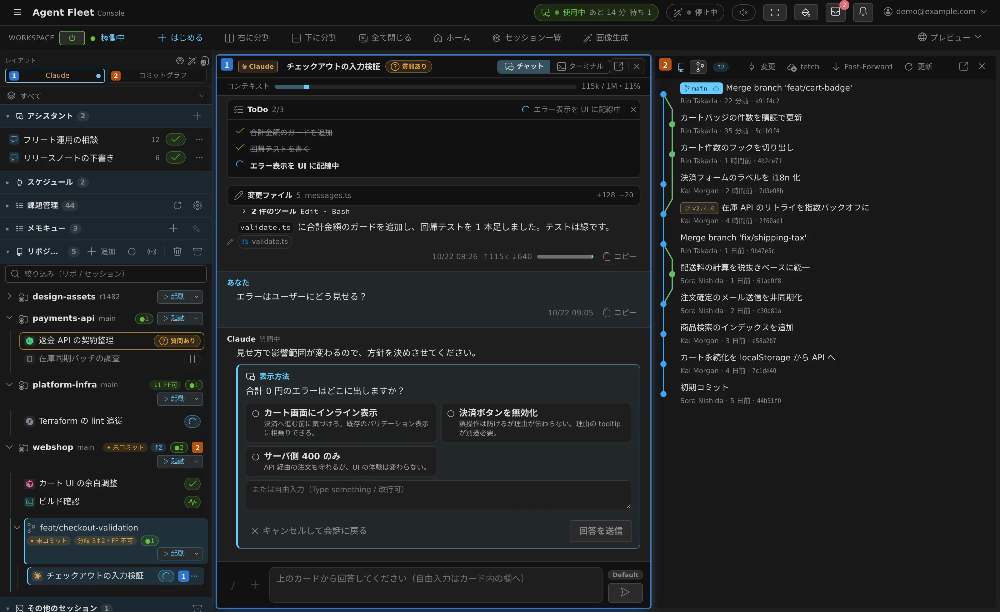

# Agent Fleet とは

[English](overview.md) | 日本語

**いつも使っている AI コーディングエージェントを、自社のサーバーで何本も同時に動かし、
ブラウザから見守って操作するための基盤です。**

## できること

- **今の CLI をそのまま使える**：Claude Code も Codex も、ログイン・モデル・振る舞いはいつもどおりです。
  Agent Fleet が受け持つのは、その周りの環境と運用です。
- **何本も同時に動かせる**：エージェントごとに自分の git worktree で作業するので、
  並行して動かしてもぶつかりません。作業中なのか、あなたの返事を待っているのかは 1 つの一覧で分かります。
- **ノートを閉じても動き続ける**：エージェントはサーバーの上で動いています。
  許可の確認はスマートフォンのブラウザや、Slack / Discord のスレッドから返せます。
- **自社の中で完結する**：1 社につき 1 つの配備を、自分たちのインフラで動かします。
  資格情報もソースコードも会話も、社外に出ません。

## 使えるエージェント

Claude Code / Codex CLI / GitHub Copilot CLI / Antigravity CLI / Cursor CLI / Kiro / OpenCode /
Muse Code、それから Agent Fleet 自身の llama.cpp ハーネス。
エージェントごとにできることの違いは [エージェント一覧](../../ref/agents.ja.md) にまとめています。

## 次に読む

| やりたいこと | ページ |
|---|---|
| とりあえず動かしてみたい | [クイックスタート](quickstart.ja.md) |
| 画面に出てくる言葉の意味を知りたい | [主な用語](concepts.ja.md) |
| チームのメンバーや上限を管理したい | [テナントの管理](../../admin/README.ja.md) |
| 自社に Agent Fleet を入れたい | [配備の運用](../../operate/README.ja.md) |
